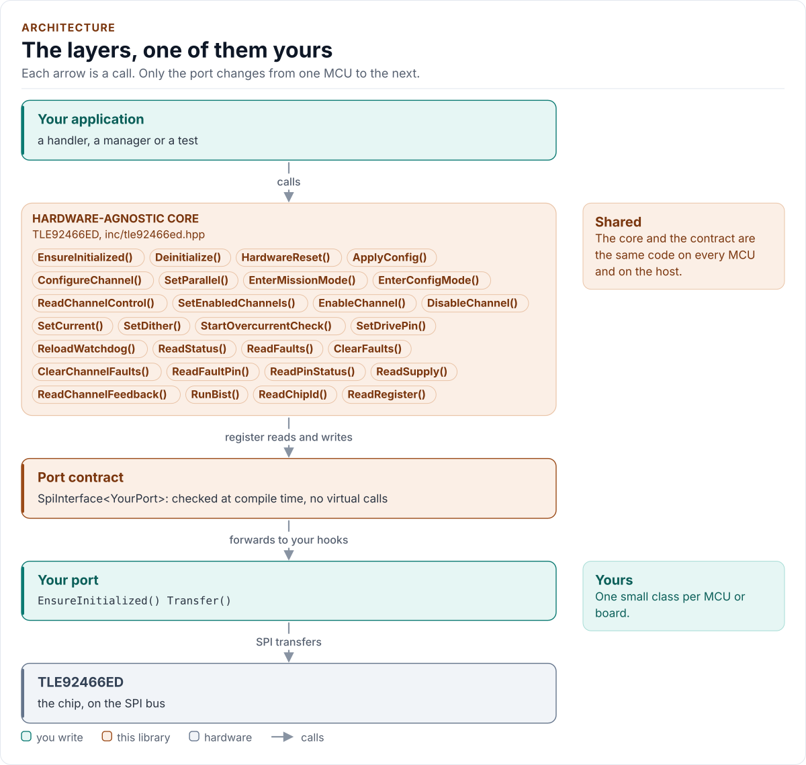

# TLE92466ED Driver

C++20 driver for the Infineon TLE92466ED six-channel low-side solenoid driver with integrated current control (SPI).

[](https://github.com/kokeb-labs-drivers/driver-tle92466ed/actions/workflows/ci.yml)
[](LICENSE)
[](docs/installation.md#requirements)

**Documentation: [`docs/`](docs/index.md)**, with the API reference built by Doxygen ([how](docs/api-reference.md)).
The site at <https://kokeb-labs-drivers.github.io/driver-tle92466ed/> opens when the repository is public.

The TLE92466ED drives six solenoids or valves from the low side and regulates each coil current itself, with an
integrating current controller, a dither generator and current feedback. This driver starts it safely, programs the
current, PWM, dither and diagnosis of each channel, reads the feedback, and turns the chip's faults into data and
errors you can act on. Every SPI reply is checked before it is used: its CRC, its width, its echo and its place in
the pipeline, so a stuck, noisy or shared bus never turns into a wrong current. It runs on any MCU: you give it a
small class that moves 32-bit frames on your bus, and it does the rest.

<!-- figure: driver-layers -->
<picture>
  <source media="(prefers-color-scheme: dark)" srcset="docs/diagrams/driver-layers.dark.svg">
  
</picture>
<!-- /figure -->

## At a glance

| | |
| --- | --- |
| **Chip** | Infineon TLE92466ED: six low-side channels with integrated current control, VDD 5 V, VIO 3.3 V or 5 V |
| **Drives** | 0 to 1.5 A per channel (1.8 A with dither), 2.43 A from a parallel pair (2.7 A range), 15-bit setpoint |
| **Measures** | Average current, duty cycle and VBAT per channel; VIO, VDD, VBAT and the die temperature |
| **Bus** | SPI mode 1, up to 8 MHz; 32-bit frames with CRC-8 SAE J1850, the reply one frame later |
| **Also drives** | RESN, EN, DRV0 and DRV1 and reads FAULTN, when your port has `GpioSet()` and `GpioRead()` |
| **Driver** | Header-only C++20; no heap, exceptions, RTTI or virtual calls; every call returns `Result<T>` |
| **Runs on** | Any MCU with SPI and a C++20 compiler; the host example runs on any PC ([Platforms](docs/platforms.md)) |
| **Status** | 0.1.0, **not verified on hardware**: host-tested against a protocol model of the chip ([Status](docs/limitations.md)) |

## Datasheet

<!-- generated: datasheet-card -->
| Document | Revision | Get it |
| --- | --- | --- |
| Datasheet: TLE92466ED (Infineon IFX-ntz1491827137291) | 1.2, 2022-02-01 | [PDF](https://www.infineon.com/assets/row/public/documents/10/49/infineon-tle92466ed-datasheet-en.pdf) · [vendor page](https://www.infineon.com/part/TLE92466ED) |

Written against these revisions; the SHA-256 of each file is in [`docs/datasheets.yml`](docs/datasheets.yml). Where each
part of the driver is in the datasheet: [Datasheet map](docs/datasheet.md).
<!-- /generated -->

Every docs page lists the datasheet sections it relies on, and code comments cite the section they implement.

## Try it on your PC

No hardware needed: [`examples/host`](examples/host/README.md) runs the driver against a simulated chip.
You need git, CMake 3.16+ and a C++20 compiler (GCC 10+, Clang 13+ or MSVC 2022).

1. Get the source:

   ```bash
   git clone https://github.com/kokeb-labs-drivers/driver-tle92466ed.git && cd driver-tle92466ed
   ```

2. Build and run the example:

   ```bash
   cmake -S examples/host -B build-example
   cmake --build build-example
   ./build-example/tle92466ed_host_example
   ```

3. You should see the driver start the simulated chip, drive channel 0 at 400 mA and read its feedback:

   ```text
   TLE92466ED driver 0.1.0 on the host
   tle92466ed: initialised, Config Mode
   ICVID version 0xFE, reset watch armed
   CH0 setpoint 399976 uA
   CH0 397714 uA, duty 40.00 %, VBAT 13981 mV
   ...
   ```

To run the whole test suite instead: `cmake -S . -B build -DTLE92466ED_BUILD_TESTS=ON && cmake --build build && ctest
--test-dir build`.

## Use it on your MCU

**1. Wire it** ([Hardware](docs/hardware.md) has every pin, the timing and the power):

| MCU | TLE92466ED | Notes |
| --- | --- | --- |
| SPI SCK | SCK (6) | Mode 1, up to 8 MHz; 2 MHz for bring-up on jumper wires |
| SPI MOSI | SI (7) | |
| SPI MISO | SO (9) | Push-pull from VIO, high impedance while CSN is high |
| GPIO (chip select) | CSN (5) | Low for the 32 bits of a frame, then high for at least 600 ns |
| GPIO | RESN (26) | Optional; low holds the chip in reset (internal pull-down) |
| GPIO | EN (27) | Optional; high lets the channels switch (internal pull-down) |
| GPIO input | FAULTN (11) | Optional; open drain, pull-up to VIO |
| MCU supply | VIO (8) | 3.3 V or 5 V: set `Config::vio` to match |
| 5 V | VDD (29) | 4.5 V to 5.5 V; 100 nF to GND |
| Load supply | VBAT (22) | 6 V to 18 V through reverse protection; the loads hang from it to LOADx |
| GND | GND, GNDPx, tab | |

**2. Write the port**: a class with `EnsureInitialized()` (bring the bus up), `Transfer()` (one 32-bit frame with
CSN low) and `DelayUs()`, about 20 lines on most SDKs. [Porting](docs/porting.md) has the contract and a complete
example.

**3. Drive a valve:**

<!-- generated: quickstart-code -->
```cpp
#include "tle92466ed.hpp"

int drive_one_valve(MyPort& port) {
  tle92466ed::Config config{};                              // reset values, no channel loaded
  config.vio = tle92466ed::VioLevel::V3V3;                  // the board's VIO
  config.channels[0] = tle92466ed::CurrentControlChannel(); // CH0: a valve, ICC, 1 kHz PWM
  tle92466ed::TLE92466ED<MyPort> driver(port, config);      // no I/O yet

  if (auto r = driver.EnsureInitialized(); !r) { // 1. reset, INIT_DONE, ICVID, every register
    return static_cast<int>(r.error);            //    Bus, NoDevice, Timeout: check the wiring
  }
  if (auto r = driver.EnterMissionMode(); !r) { // 2. EN high, OP_MODE = 1
    return static_cast<int>(r.error);           //    MissionBlocked: read the faults
  }
  if (auto r = driver.SetCurrent(tle92466ed::Channel::Ch0, 400'000); !r) { // 3. 400 mA
    return static_cast<int>(r.error);
  }
  return static_cast<int>(driver.EnableChannel(tle92466ed::Channel::Ch0).error); // 4. on
}
```
<!-- /generated -->

`EnsureInitialized()` is the only call that starts the chip. Every other call returns `Error::NotInitialized`
until it has succeeded, and no call ever starts the chip on its own.

## What it does

- Starts the chip: RESN pulse (or t_POR), INIT_DONE, the ICVID identity, the faults found before the start
  reported and cleared, then every register written from a `Config` that holds the reset values.
- Enters and leaves Mission Mode, refusing it while a fault of the datasheet's state diagram holds the chip.
- Sets each channel's mode, current setpoint (checked against the operating range, never clamped), PWM frequency
  controller, dither, slew rate and diagnosis; joins channel pairs for up to 2.43 A.
- Reads the average current, duty cycle and VBAT of a channel under the feedback freeze, and refuses to report a
  current when there is no measurement period.
- Reads and clears every diagnosis flag, keeps a latch of what any read saw, runs the self-test and the OFF-state
  overcurrent check, reloads the SPI watchdog.
- Checks every reply (CRC, reply width, R/W echo, status, stuck and looped-back lines, the anchor read of the
  pipeline), retries reads a bounded number of times and never retries a write.
- Returns `Result<T>` with an `Error` from every call: no exceptions, no heap, no RTTI, no virtual calls.

## Add it to your project

Pick the row that matches your build; each is a few steps, and [Installation](docs/installation.md) has the
details.

| Your build | Steps below |
| --- | --- |
| Plain CMake: STM32 (CubeMX), RP2040 (Pico SDK), nRF Connect, a host app | [A](#a-cmake-any-mcu) |
| ESP-IDF | [B](#b-esp-idf) |
| An SDK or OS image that installs libraries | [C](#c-installed-package) |

### A. CMake, any MCU

1. Add the driver as a submodule, pinned to the version you chose:

   ```bash
   git submodule add https://github.com/kokeb-labs-drivers/driver-tle92466ed.git external/driver-tle92466ed
   ```

2. In your `CMakeLists.txt`, after `project()`:

   ```cmake
   add_subdirectory(external/driver-tle92466ed)
   target_link_libraries(my_app PRIVATE tle92466ed::tle92466ed)   # brings the headers and C++20
   ```

3. In your code, `#include "tle92466ed.hpp"`, write the port ([Porting](docs/porting.md)) and build. A first build
   that compiles the quickstart above is the check that the driver is wired in.

### B. ESP-IDF

1. Add the driver under your project's `components/`; ESP-IDF finds it there and names it after the folder:

   ```bash
   git submodule add https://github.com/kokeb-labs-drivers/driver-tle92466ed.git components/tle92466ed
   ```

2. In `main/CMakeLists.txt`, list it: `idf_component_register(SRCS "main.cpp" REQUIRES tle92466ed)`.
3. `idf.py menuconfig` now has a **TLE92466ED solenoid driver** menu (VIO, CRC, SPI watchdog, clock, timing),
   and `idf.py build` builds the driver with your app. [`examples/esp32`](examples/esp32) is a complete
   project with a port for the board.

### C. Installed package

1. Install it once into a prefix:

   ```bash
   cmake -S external/driver-tle92466ed -B build-tle92466ed && cmake --install build-tle92466ed --prefix /opt/sdk
   ```

2. In your project, with `CMAKE_PREFIX_PATH=/opt/sdk`:

   ```cmake
   find_package(tle92466ed 0.1 REQUIRED)
   target_link_libraries(my_app PRIVATE tle92466ed::tle92466ed)
   ```

The target is `tle92466ed::tle92466ed` every way, so switching later changes nothing else.

## Documentation

| Page | Read it when you want to |
| --- | --- |
| [Quickstart](docs/quickstart.md) | Go from a bare chip to a regulated coil current on your MCU |
| [Hardware](docs/hardware.md) | Wire it, check the bus settings, the timing and the power |
| [Porting](docs/porting.md) | Write the port class for your MCU's SDK |
| [API guide](docs/api-guide.md) | Use each call: start, states, channels, feedback, faults, watchdog, errors |
| [Configuration](docs/configuration.md) | Choose every setting, or start from the current-control preset |
| [Troubleshooting](docs/troubleshooting.md) | Find the cause of an error, a fault or a wrong reading |
| [Status and limitations](docs/limitations.md) | See what is verified, what is not, and the bench steps |
| [Contract](docs/contract.md) | Know exactly what the driver promises, needs and returns |
| [Datasheet map](docs/datasheet.md) | Find the datasheet section behind each part of the driver |
| [API reference](docs/api-reference.md) | Look up a class or member (Doxygen; built by CI and locally) |

## Tests and quality

```bash
cmake -S . -B build -DTLE92466ED_BUILD_TESTS=ON && cmake --build build && ctest --test-dir build
```

The host tests run the driver against a protocol model of the chip, fail every bus transfer in turn, inject stuck,
looped-back, corrupted, ignored and lost frames, and produce each error the driver can return. A fuzzer fails,
corrupts and replaces what the chip sends back and checks the driver's promises after every call. CI also builds for
Cortex-M and gates coverage, complexity, sanitizers, fuzzing, clang-tidy, cppcheck and the handbook rules
(`.kokeb/handbook.yml`). See [Testing and CI](docs/testing.md), which lists every gate and its limit.

## License

MIT. See [LICENSE](LICENSE).
