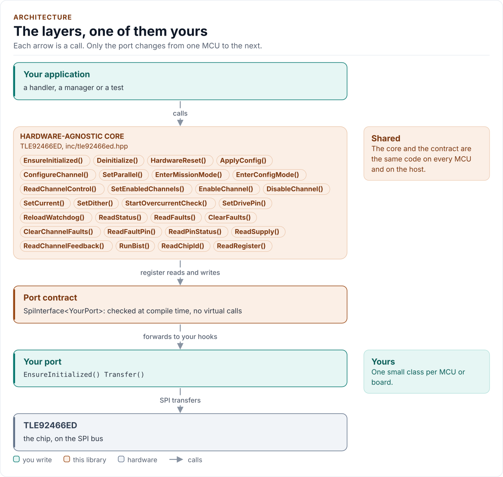
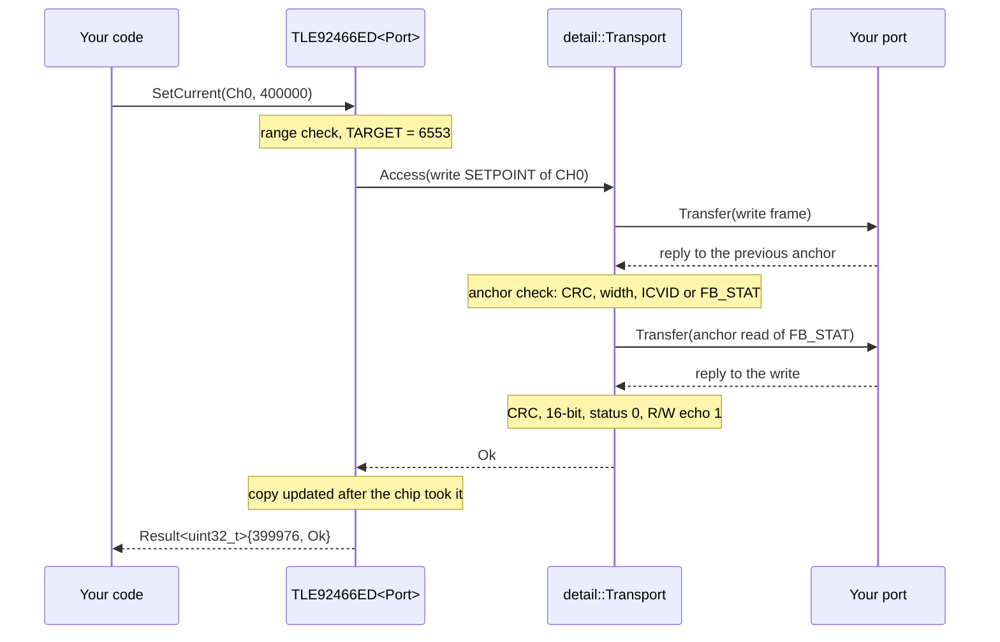

# Architecture

How the driver is built: three layers, one of them yours, how one call travels through them, and how every SPI
reply is checked before it is used.

<!-- generated: datasheet-refs -->
??? abstract "Datasheet sections this page relies on"

    From Infineon IFX-ntz1491827137291 1.2:

    - Reset State, Config Mode, Mission Mode and Critical Fault: 4.3.1 TDS_IC Operation states; Figure 4, [p. 19](https://www.infineon.com/assets/row/public/documents/10/49/infineon-tle92466ed-datasheet-en.pdf#page=19)
    - Feedback freeze and update: 4.10.5 TDS_Update/Freeze Mechanism; Figure 22, [p. 43](https://www.infineon.com/assets/row/public/documents/10/49/infineon-tle92466ed-datasheet-en.pdf#page=43)
    - SPI frame, mode and CRC-8 SAE J1850: 5.1.1 TDS_General information; 5.1.2 TDS_Cyclic redundancy check (CRC), [p. 47](https://www.infineon.com/assets/row/public/documents/10/49/infineon-tle92466ed-datasheet-en.pdf#page=47)
    - The reply pipeline, frames and reply status: 5.2.1 TDS_Data flow; 5.2.3 SPI frame definition, [p. 50](https://www.infineon.com/assets/row/public/documents/10/49/infineon-tle92466ed-datasheet-en.pdf#page=50)
    - Central registers, reset values and bit types: 5.3.1 Overview of Register Types; 5.3.2 Central registers, [p. 54](https://www.infineon.com/assets/row/public/documents/10/49/infineon-tle92466ed-datasheet-en.pdf#page=54)
    - FB_STAT, the status summary: 5.3.2.21 Feedback Status Register, [p. 77](https://www.infineon.com/assets/row/public/documents/10/49/infineon-tle92466ed-datasheet-en.pdf#page=77)
    - Channel registers and their bank addresses: 5.3.3 Channel registers, Tables 24 and 25, [p. 85](https://www.infineon.com/assets/row/public/documents/10/49/infineon-tle92466ed-datasheet-en.pdf#page=85)

    All of them, with the driver API for each: [Datasheet map](datasheet.md).
<!-- /generated -->

<!-- figure: driver-layers -->
<picture>
  <source media="(prefers-color-scheme: dark)" srcset="diagrams/driver-layers.dark.svg">
  
</picture>
<!-- /figure -->

## Layers

| Layer | Files | Owns |
| --- | --- | --- |
| Core | [`inc/tle92466ed.hpp`](../inc/tle92466ed.hpp), [`src/tle92466ed.ipp`](../src/tle92466ed.ipp) | Start-up, operation states, channels, feedback, diagnosis, the driver's copies and latch |
| Types and registers | [`inc/tle92466ed_types.hpp`](../inc/tle92466ed_types.hpp), [`inc/tle92466ed_registers.hpp`](../inc/tle92466ed_registers.hpp) | `Error`, `Result<T>`, `Config` and `Validate()`, decoded values, conversions; the register map and CRC |
| Port contract | [`inc/tle92466ed_spi_interface.hpp`](../inc/tle92466ed_spi_interface.hpp) | The CRTP base, `CtrlPin` and `GpioSignal`, the `SpiPort` concept, the bus requirements, the frame codec and the pipeline (`detail::Transport`) |
| Platform port | Your class | Bus bring-up and 32-bit frames, delays, optionally the control pins and logging |
| Kconfig layer | [`inc/tle92466ed_kconfig.hpp`](../inc/tle92466ed_kconfig.hpp) | Optional: a `Config` from ESP-IDF menuconfig |

## One call through the layers

## The SPI pipeline

The chip answers each frame during the next one (section 5.2.1), and a reply carries no address, so the driver
completes every access inside one call, in two frames: the request, then an **anchor read** whose reply arrives with
the next access. The anchor differs in width from the request's reply: FB_STAT (22 bits) after a write or a 16-bit
read, ICVID (16 bits) after a 22-bit read. A request the chip never took then leaves the previous anchor's reply in
its slot, and that reply fails the width check instead of passing as data.

Every word read is checked in this order before anything decodes it (`detail::DecodeReply()`):

| Check | Section | On failure |
| --- | --- | --- |
| All zeros, all ones, or the frame just sent (a looped-back MOSI) | KB-CPP-116 | `NoDevice` |
| Reply mode 10B: the critical fault frame (bits 31..24 are don't care, so no CRC), confirmed by one more frame | 5.2.3.5 | `CriticalFault`, flags kept, EN low; a single one is `ReplyMismatch` |
| CRC-8 SAE J1850 of bits 23..0 | 5.1.2 | `Crc` |
| Reply mode 11B (reserved) or the wrong width for the request | 5.2.3.3, 5.2.3.4 | `ReplyMismatch` |
| Status of a 16-bit reply: CRC error, frame error, read-only write, internal bus fault | 5.2.3.3 | `Crc`, `FrameRejected`, `DeviceFault` |
| The R/W echo of a 16-bit reply | 5.2.3.3 | `ReplyMismatch` |
| The same word in both slots (the chip ignored the request and repeated its last reply) | 5.1.1 | `ReplyMismatch` |
| The previous anchor: ICVID manufacturer 0xC1; FB_STAT without POR_event or RES_event | 5.3.2.19, 4.1.1 | `ReplyMismatch`, `UnexpectedReset` |

After any failure the next access first sends one anchor frame alone and discards its reply, so the pipeline is in
a known state again (KB-CPP-118). A read whose reply failed a check is repeated up to `Config::max_retries` times,
except DIAG_WARN_CHGR, which a read changes (4.9.3); a port failure, a confirmed critical fault frame and a
detected reset are not. A write is never repeated: its outcome is
unknown, and `Verify::ReadBack` is the way to settle it. `GetBusDiagnostics()` counts frames, retries, rejected
replies and resyncs.

## State the driver keeps

| Copy | Updated | Why |
| --- | --- | --- |
| CH_CTRL (`IsMissionMode()`, `GetEnabledChannels()`) | From a read of CH_CTRL before every enable change and after `EnterMissionMode()`, and after the chip took a write | The chip clears EN_CH and OP_MODE on its own; a write is the register as read with only what the call names changed (KB-CPP-121, -122) |
| TARGET per channel (`GetCurrentSetpoint()`) | After the chip took the write | The programmed value, with the pair's scale |
| The fault latch (`GetLatchedFaults()`) | Every read of a diagnosis register | Clear-on-read and clear-on-write flags are never lost to an internal read (KB-CPP-119) |
| The start-up faults (`GetStartupFaults()`) | Each start | What the chip held before the driver cleared it |
| The configuration (`GetConfig()`) | After the chip took it | Conversions use the chip's actual settings (KB-CPP-128) |

## Feedback

`ReadChannelFeedback()` follows the readout of Figure 22 (section 4.10.5): FB_UPD shows new values; FB_FRZ freezes
the channel's feedback registers so FB_DC, FB_VBAT, FB_I_AVG, FB_IMIN_IMAX and FB_PERIOD_MIN_MAX come from one
measurement period; releasing the freeze clears the FB_UPD bit. A TP_MANT of 0 (no measurement period, for example
a dither clock of 0, section 4.4.2) is `NotReady`, never a current of 0 (KB-CPP-127).

## Design choices

- **CRTP, not virtual functions.** The port is a template parameter constrained by the `SpiPort` concept, so every
  call is resolved at compile time and a missing hook is a compile error that names it.
- **Optional hooks by named concepts.** `GpioSet`, `GpioRead` and `Log` are detected by `detail::Has*`
  concepts; a hook declared with another signature is a compile error, never ignored. `DelayUs` is required.
- **No I/O in the constructor.** Construction cannot fail, so the driver can be a static or a member of a handler.
- **One error type.** `Result<T>` carries a value and an `Error`; nothing throws and nothing returns a bare `bool`.
- **No heap, no exceptions, no RTTI, no `std::function`, no `printf`.** The driver is a header-only template with
  no mutable static state; the frame buffers belong to the driver object.

## Source map

| You want | Read |
| --- | --- |
| The public API | [`inc/tle92466ed.hpp`](../inc/tle92466ed.hpp) |
| How a call is implemented | [`src/tle92466ed.ipp`](../src/tle92466ed.ipp) |
| Register addresses, bits and the CRC | [`inc/tle92466ed_registers.hpp`](../inc/tle92466ed_registers.hpp) |
| The port contract, the frames and the pipeline | [`inc/tle92466ed_spi_interface.hpp`](../inc/tle92466ed_spi_interface.hpp) |

Next: [Contract](contract.md).
