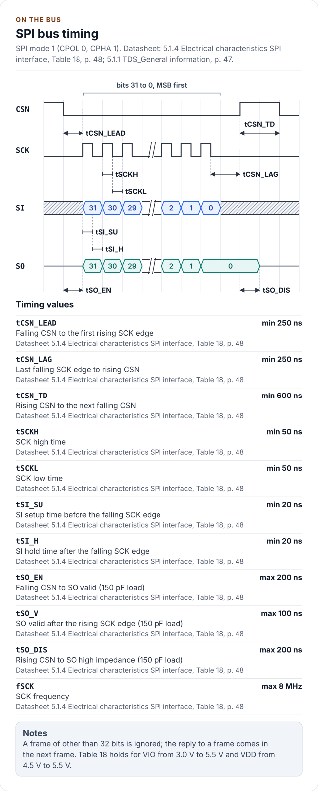

# On the bus

What the TLE92466ED needs from the SPI bus, signal by signal, with every time and rate taken from the datasheet. The
frame layout and the CRC are on the [Hardware](hardware.md) page; this page is the waveform under them.

## SPI timing

The TLE92466ED shifts SO out on the rising edge of SCK and reads SI on the falling edge, with SCK idle low: SPI
mode 1. Every frame is 32 bits, MSB first, in one CSN low phase, and the chip answers it during the next frame.

<!-- figure: spi-timing -->
<picture>
  <source media="(prefers-color-scheme: dark)" srcset="diagrams/spi-timing.dark.svg">
  
</picture>
<!-- /figure -->

## Several devices

The datasheet describes no daisy chain: a frame of other than 32 bits is ignored, so several TLE92466ED on one SPI
bus share SCK, SI and SO and each needs its own CSN. SO is high impedance while CSN is high, so the chips can share
the SO line.

## How these figures are made

The figure is a model in `docs/model/` (`spi-timing.timing.yml`) that cites the datasheet section and page of every
number; `kokeb-docs figures` draws it and the build fails on a number without a citation. The values table under the
waveform is also written as `docs/diagrams/spi-timing.table.html`.
