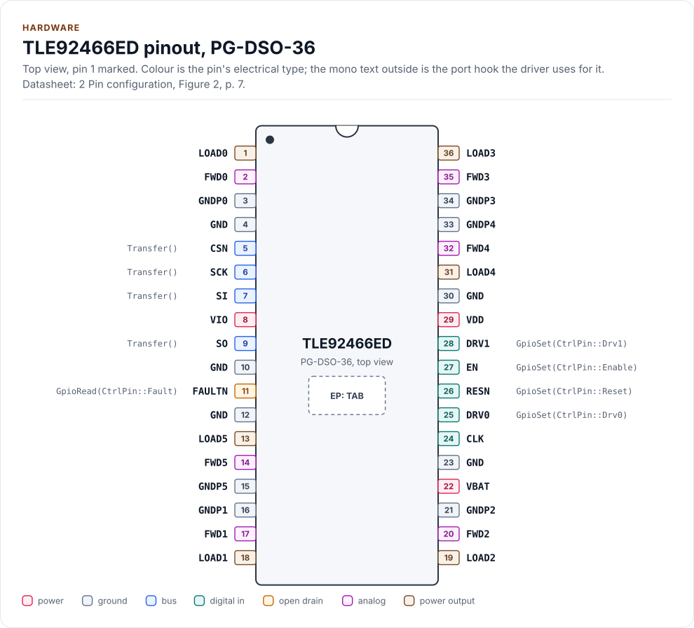
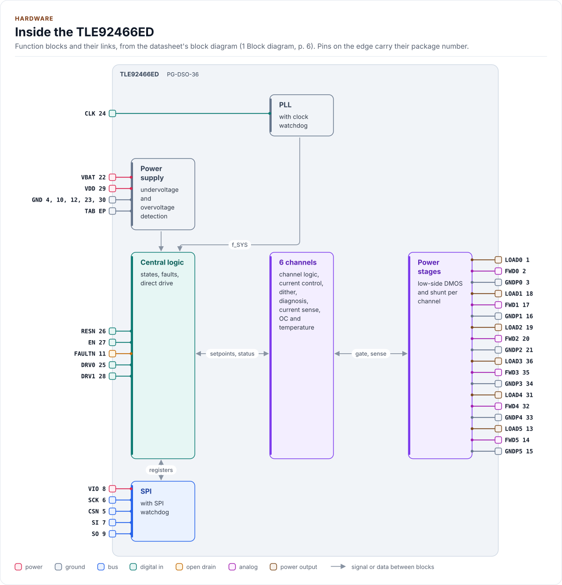
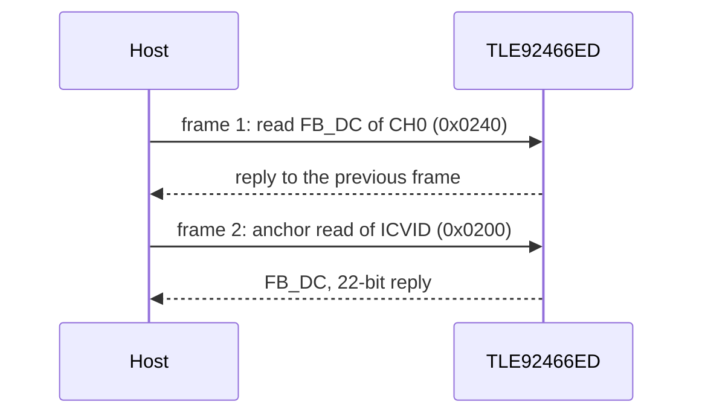

# Hardware

The TLE92466ED's pins, bus settings, timing and power, as the driver uses them. Section numbers refer to the
datasheet, Rev. 1.2.

<!-- generated: datasheet-refs -->
??? abstract "Datasheet sections this page relies on"

    From Infineon IFX-ntz1491827137291 1.2:

    - Pins, RESN, EN, DRV0/DRV1 and FAULTN: 2 Pin configuration; 4.2.3 TDS_I/O Pins, [p. 7](https://www.infineon.com/assets/row/public/documents/10/49/infineon-tle92466ed-datasheet-en.pdf#page=7)
    - Functional range of VDD, VBAT, VIO, f_SYS and f_PWM: 3.2.1 Functional range, Table 6, [p. 11](https://www.infineon.com/assets/row/public/documents/10/49/infineon-tle92466ed-datasheet-en.pdf#page=11)
    - Supplies, VIO_SEL and the power-on reset: 4.1.1 TDS_Power Supply, [p. 14](https://www.infineon.com/assets/row/public/documents/10/49/infineon-tle92466ed-datasheet-en.pdf#page=14)
    - Reset times t_RESN and t_POR: 4.1.3 Electrical characteristics power supply, Table 9, [p. 15](https://www.infineon.com/assets/row/public/documents/10/49/infineon-tle92466ed-datasheet-en.pdf#page=15)
    - Clock source, PLL dividers and INIT_DONE: 4.2.1 TDS_Clock; Equations 2, 3; Table 10, [p. 16](https://www.infineon.com/assets/row/public/documents/10/49/infineon-tle92466ed-datasheet-en.pdf#page=16)
    - Direct drive via SPI on-time and DRV pins: 4.8.1 TDS_Direct Drive; Equation 10, [p. 32](https://www.infineon.com/assets/row/public/documents/10/49/infineon-tle92466ed-datasheet-en.pdf#page=32)
    - SPI frame, mode and CRC-8 SAE J1850: 5.1.1 TDS_General information; 5.1.2 TDS_Cyclic redundancy check (CRC), [p. 47](https://www.infineon.com/assets/row/public/documents/10/49/infineon-tle92466ed-datasheet-en.pdf#page=47)
    - SPI timing: 5.1.4 Electrical characteristics SPI interface, Table 18, [p. 48](https://www.infineon.com/assets/row/public/documents/10/49/infineon-tle92466ed-datasheet-en.pdf#page=48)
    - Identity, ICVID and CHIPID: 5.3.2.19 Version Register; 5.3.2.24 Unique Chip Identification Number Register 0, [p. 75](https://www.infineon.com/assets/row/public/documents/10/49/infineon-tle92466ed-datasheet-en.pdf#page=75)
    - Application circuit: 6.1 TDS_Application information; Figure 26, [p. 105](https://www.infineon.com/assets/row/public/documents/10/49/infineon-tle92466ed-datasheet-en.pdf#page=105)

    All of them, with the driver API for each: [Datasheet map](datasheet.md).
<!-- /generated -->

## Pins

The PG-DSO-36 package from the top (section 2, Figure 2 and Table 1), with the cooling tab underneath.

<!-- figure: chip-pinout -->
<picture>
  <source media="(prefers-color-scheme: dark)" srcset="diagrams/chip-pinout.dark.svg">
  
</picture>
<!-- /figure -->

<!-- generated: chip-pins -->
PG-DSO-36, 36 pins and an exposed pad (2 Pin configuration, Figure 2, [p. 7](https://www.infineon.com/assets/row/public/documents/10/49/infineon-tle92466ed-datasheet-en.pdf#page=7)).

| Pin | Name | Type (domain) | Function | Driver hook | If unused | Datasheet |
| --- | --- | --- | --- | --- | --- | --- |
| 1 | `LOAD0` | power output (VBAT) | Low-side output, channel 0 | - | Leave open | 2, [p. 7](https://www.infineon.com/assets/row/public/documents/10/49/infineon-tle92466ed-datasheet-en.pdf#page=7) |
| 2 | `FWD0` | analog (VBAT) | Freewheeling diode of channel 0 | - | Leave open | 2, [p. 7](https://www.infineon.com/assets/row/public/documents/10/49/infineon-tle92466ed-datasheet-en.pdf#page=7) |
| 3 | `GNDP0` | ground | Power-stage ground, channel 0 | - | - | 2, [p. 7](https://www.infineon.com/assets/row/public/documents/10/49/infineon-tle92466ed-datasheet-en.pdf#page=7) |
| 4 | `GND` | ground | Signal ground; connected to the cooling tab | - | - | 2, [p. 7](https://www.infineon.com/assets/row/public/documents/10/49/infineon-tle92466ed-datasheet-en.pdf#page=7) |
| 5 | `CSN` | bus (VIO) | SPI chip select, active low; internal pull-up | `Transfer()` | - | 2, [p. 7](https://www.infineon.com/assets/row/public/documents/10/49/infineon-tle92466ed-datasheet-en.pdf#page=7) |
| 6 | `SCK` | bus (VIO) | SPI clock, up to 8 MHz; internal pull-down | `Transfer()` | - | 5.1.4, [p. 48](https://www.infineon.com/assets/row/public/documents/10/49/infineon-tle92466ed-datasheet-en.pdf#page=48) |
| 7 | `SI` | bus (VIO) | SPI data in (MOSI); internal pull-down | `Transfer()` | - | 2, [p. 7](https://www.infineon.com/assets/row/public/documents/10/49/infineon-tle92466ed-datasheet-en.pdf#page=7) |
| 8 | `VIO` | power (VIO) | Supply of SO, 3.3 V or 5 V (3.0 V to 5.5 V) | - | - | 3.2.1, [p. 11](https://www.infineon.com/assets/row/public/documents/10/49/infineon-tle92466ed-datasheet-en.pdf#page=11) |
| 9 | `SO` | bus (VIO) | SPI data out (MISO), push-pull from VIO | `Transfer()` | - | 2, [p. 7](https://www.infineon.com/assets/row/public/documents/10/49/infineon-tle92466ed-datasheet-en.pdf#page=7) |
| 10 | `GND` | ground | Signal ground; connected to the cooling tab | - | - | 2, [p. 7](https://www.infineon.com/assets/row/public/documents/10/49/infineon-tle92466ed-datasheet-en.pdf#page=7) |
| 11 | `FAULTN` | open drain (VIO) | Fault output, low on a critical fault, RESN low or an unmasked fault | `GpioRead(CtrlPin::Fault)` | Leave open | 4.2.3, [p. 17](https://www.infineon.com/assets/row/public/documents/10/49/infineon-tle92466ed-datasheet-en.pdf#page=17) |
| 12 | `GND` | ground | Signal ground; connected to the cooling tab | - | - | 2, [p. 7](https://www.infineon.com/assets/row/public/documents/10/49/infineon-tle92466ed-datasheet-en.pdf#page=7) |
| 13 | `LOAD5` | power output (VBAT) | Low-side output, channel 5 | - | Leave open | 2, [p. 7](https://www.infineon.com/assets/row/public/documents/10/49/infineon-tle92466ed-datasheet-en.pdf#page=7) |
| 14 | `FWD5` | analog (VBAT) | Freewheeling diode of channel 5 | - | Leave open | 2, [p. 7](https://www.infineon.com/assets/row/public/documents/10/49/infineon-tle92466ed-datasheet-en.pdf#page=7) |
| 15 | `GNDP5` | ground | Power-stage ground, channel 5 | - | - | 2, [p. 7](https://www.infineon.com/assets/row/public/documents/10/49/infineon-tle92466ed-datasheet-en.pdf#page=7) |
| 16 | `GNDP1` | ground | Power-stage ground, channel 1 | - | - | 2, [p. 7](https://www.infineon.com/assets/row/public/documents/10/49/infineon-tle92466ed-datasheet-en.pdf#page=7) |
| 17 | `FWD1` | analog (VBAT) | Freewheeling diode of channel 1 | - | Leave open | 2, [p. 7](https://www.infineon.com/assets/row/public/documents/10/49/infineon-tle92466ed-datasheet-en.pdf#page=7) |
| 18 | `LOAD1` | power output (VBAT) | Low-side output, channel 1 | - | Leave open | 2, [p. 8](https://www.infineon.com/assets/row/public/documents/10/49/infineon-tle92466ed-datasheet-en.pdf#page=8) |
| 19 | `LOAD2` | power output (VBAT) | Low-side output, channel 2 | - | Leave open | 2, [p. 8](https://www.infineon.com/assets/row/public/documents/10/49/infineon-tle92466ed-datasheet-en.pdf#page=8) |
| 20 | `FWD2` | analog (VBAT) | Freewheeling diode of channel 2 | - | Leave open | 2, [p. 8](https://www.infineon.com/assets/row/public/documents/10/49/infineon-tle92466ed-datasheet-en.pdf#page=8) |
| 21 | `GNDP2` | ground | Power-stage ground, channel 2 | - | - | 2, [p. 8](https://www.infineon.com/assets/row/public/documents/10/49/infineon-tle92466ed-datasheet-en.pdf#page=8) |
| 22 | `VBAT` | power (VBAT) | Battery supply through reverse protection and filter, 6 V to 18 V | - | - | 3.2.1, [p. 11](https://www.infineon.com/assets/row/public/documents/10/49/infineon-tle92466ed-datasheet-en.pdf#page=11) |
| 23 | `GND` | ground | Signal ground; connected to the cooling tab | - | - | 2, [p. 8](https://www.infineon.com/assets/row/public/documents/10/49/infineon-tle92466ed-datasheet-en.pdf#page=8) |
| 24 | `CLK` | digital in (VIO) | External clock, 1 MHz to 8 MHz; internal pull-down | - | Connect to GND | 4.2.3, [p. 17](https://www.infineon.com/assets/row/public/documents/10/49/infineon-tle92466ed-datasheet-en.pdf#page=17) |
| 25 | `DRV0` | digital in (VIO) | Direct-drive input 0; internal pull-down | `GpioSet(CtrlPin::Drv0)` | Connect to GND | 4.2.3, [p. 17](https://www.infineon.com/assets/row/public/documents/10/49/infineon-tle92466ed-datasheet-en.pdf#page=17) |
| 26 | `RESN` | digital in (VIO) | Reset, active low; internal pull-down | `GpioSet(CtrlPin::Reset)` | - | 4.2.3, [p. 17](https://www.infineon.com/assets/row/public/documents/10/49/infineon-tle92466ed-datasheet-en.pdf#page=17) |
| 27 | `EN` | digital in (VIO) | Enable, active high: low turns every channel off; internal pull-down | `GpioSet(CtrlPin::Enable)` | - | 4.2.3, [p. 17](https://www.infineon.com/assets/row/public/documents/10/49/infineon-tle92466ed-datasheet-en.pdf#page=17) |
| 28 | `DRV1` | digital in (VIO) | Direct-drive input 1; internal pull-down | `GpioSet(CtrlPin::Drv1)` | Connect to GND | 4.2.3, [p. 17](https://www.infineon.com/assets/row/public/documents/10/49/infineon-tle92466ed-datasheet-en.pdf#page=17) |
| 29 | `VDD` | power (VDD) | 5 V supply of the digital circuits (4.5 V to 5.5 V) | - | - | 3.2.1, [p. 11](https://www.infineon.com/assets/row/public/documents/10/49/infineon-tle92466ed-datasheet-en.pdf#page=11) |
| 30 | `GND` | ground | Signal ground; connected to the cooling tab | - | - | 2, [p. 8](https://www.infineon.com/assets/row/public/documents/10/49/infineon-tle92466ed-datasheet-en.pdf#page=8) |
| 31 | `LOAD4` | power output (VBAT) | Low-side output, channel 4 | - | Leave open | 2, [p. 8](https://www.infineon.com/assets/row/public/documents/10/49/infineon-tle92466ed-datasheet-en.pdf#page=8) |
| 32 | `FWD4` | analog (VBAT) | Freewheeling diode of channel 4 | - | Leave open | 2, [p. 8](https://www.infineon.com/assets/row/public/documents/10/49/infineon-tle92466ed-datasheet-en.pdf#page=8) |
| 33 | `GNDP4` | ground | Power-stage ground, channel 4 | - | - | 2, [p. 8](https://www.infineon.com/assets/row/public/documents/10/49/infineon-tle92466ed-datasheet-en.pdf#page=8) |
| 34 | `GNDP3` | ground | Power-stage ground, channel 3 | - | - | 2, [p. 8](https://www.infineon.com/assets/row/public/documents/10/49/infineon-tle92466ed-datasheet-en.pdf#page=8) |
| 35 | `FWD3` | analog (VBAT) | Freewheeling diode of channel 3 | - | Leave open | 2, [p. 8](https://www.infineon.com/assets/row/public/documents/10/49/infineon-tle92466ed-datasheet-en.pdf#page=8) |
| 36 | `LOAD3` | power output (VBAT) | Low-side output, channel 3 | - | Leave open | 2, [p. 8](https://www.infineon.com/assets/row/public/documents/10/49/infineon-tle92466ed-datasheet-en.pdf#page=8) |
| EP | `TAB` | ground | Cooling tab; connect to GND and the heat sink area | - | - | 2, [p. 8](https://www.infineon.com/assets/row/public/documents/10/49/infineon-tle92466ed-datasheet-en.pdf#page=8) |

Source of this table and of the chip figures: [`docs/hardware.yml`](hardware.yml).
<!-- /generated -->

The five GND pins and the tab are the signal ground; each channel's power stage has its own GNDPx, which connects
to the same ground. Set `Config::vio` to the VIO level (the MCU's I/O supply). CLK is the external PLL clock, 1 MHz
to 8 MHz; with the internal oscillator, tie it to GND. The pinout, the block diagram, the circuit and both tables
are drawn from [`docs/hardware.yml`](hardware.yml).

## Inside the chip

Section 1, Figure 1: the central logic takes the control pins and the SPI registers and runs six identical channels,
each with its own channel logic, current control and dither, diagnosis, current sense, overcurrent and temperature
protection, and a low-side DMOS with its shunt. The power supply block reports undervoltage and overvoltage to the
central logic; the PLL makes the system clock f_SYS.

<!-- figure: chip-blocks -->
<picture>
  <source media="(prefers-color-scheme: dark)" srcset="diagrams/chip-blocks.dark.svg">
  
</picture>
<!-- /figure -->

## Control pins

The driver drives RESN, EN, DRV0 and DRV1 only through the optional `GpioSet()` hook of your port, with logical
levels (`GpioSignal::ACTIVE` on RESN means "in reset", which your port writes as a low level), and reads FAULTN
through the optional `GpioRead()` hook. Their idle levels, which your port drives before it enables each output:

| Pin | Idle level | Why |
| --- | --- | --- |
| RESN | Low, `ACTIVE` (in reset) | Every register at its reset value and every channel off until the driver starts the chip |
| EN | Low, `INACTIVE` | Every channel off; the driver raises it in `EnterMissionMode()` and lowers it in `EnterConfigMode()` |
| DRV0, DRV1 | Low, `INACTIVE` | A direct-drive channel stays off until the application drives the pin |
| CSN | High | The SPI driver's job; the chip ignores the bus while CSN is high |

Without `GpioSet()`, tie RESN and EN high (through a resistor) and DRVx low: `EnsureInitialized()` then waits
t_POR instead of pulsing RESN and writes every register, since the chip may keep what an earlier run wrote, and
`HardwareReset()` and `SetDrivePin()` return `Error::Unsupported`.

## Bus settings

| Setting | Value (sections 5.1, 5.2; Table 18) | Driver constant |
| --- | --- | --- |
| SPI mode | 1: SCK idles low, SO changes on the rising edge, SI is sampled on the falling edge | `kSpiMode` |
| Clock | Up to 8 MHz | `kMaxClockHz` |
| Bit order | MSB first on SI and SO | `kMsbFirst` |
| Frame | 32 bits in one CSN low period; any other length is ignored | `kFrameBytes` |
| CSN high between frames | At least 600 ns (t_CSN_TD) | `kMinCsHighNs` |
| CSN to SCK, SCK to CSN | At least 250 ns (t_CSN_LEAD, t_CSN_LAG) | `kCsSetupNs`, `kCsHoldNs` |

Every frame carries a CRC-8 SAE J1850 (polynomial 0x1D, initial value 0xFF, final XOR 0xFF) in bits 31..24,
computed over bits 7..0, 15..8 and 23..16 in that order (section 5.1.2). The chip answers each frame during the
next one (section 5.2.1):

| Frame | Bits 31..24 | 23..17 | 16 | 15..0 |
| --- | --- | --- | --- | --- |
| Write (5.2.3.1) | CRC | 7-bit address | 1 | Data |
| Read (5.2.3.2) | CRC | Don't care (sent as 1100000B) | 0 | 16-bit address |
| 16-bit reply (5.2.3.3) | CRC | Reply mode 00, 5-bit status | R/W echo | Data |
| 22-bit reply (5.2.3.4) | CRC | Reply mode 01, data 21..16 | Data 16 | Data |
| Critical fault frame (5.2.3.5) | Don't care | Reply mode 10 | Don't care | Bits 7..0: supply and clock flags |

[Architecture](architecture.md#the-spi-pipeline) shows how the driver checks each reply.

## Timing

| Parameter | Symbol | Value | Driver |
| --- | --- | --- | --- |
| Logic ready after RESN released | t_RESN | 0.1 ms maximum (Table 9) | `kResetReleaseUs`, then INIT_DONE polled |
| Logic ready after a power-on reset | t_POR | 10 ms maximum (Table 9) | `kPowerOnResetUs`, waited when the port has no `GpioSet()` |
| RESN low pulse | none | Not specified: 1 ms is the design value | `kResetPulseUs` (**not verified on hardware**) |
| INIT_DONE after a reset or a clock change | none | Not specified | Polled every `kPollIntervalUs` for `Config::init_timeout_us` |
| SPI watchdog count | f_SPI,WD | f_SYS / 2^14, 0.585 ms per count at 28 MHz | `WatchdogReloadCode()`, at most 2047 counts (1.198 s) |
| Overcurrent shutdown | t_OC,DETECT | 1.5 µs maximum | The chip's own |

## Power and supervision

| Supply | Range (Table 6) | Monitored (section 4.1.2) |
| --- | --- | --- |
| VDD | 4.5 V to 5.5 V; SPI works from 3.5 V | UV 3.7 V to 4.5 V, OV 5.5 V to 6.4 V |
| VIO | 3.0 V to 5.5 V | Against the 3.3 V or the 5 V thresholds that VIO_SEL selects |
| VBAT | 6 V to 18 V (4 V to 38 V with deviations) | `Config::vbat_uv_code` and `vbat_ov_code`, 162 mV per count |

A VDD or VIO fault ends Mission Mode and clears every EN_CH; a VBAT fault is reported only. With VIO_SEL on the
wrong level (the reset value is 5 V), a 3.3 V VIO reads as undervoltage and `EnterMissionMode()` returns
`MissionBlocked`. VDD draws up to 40 mA; VBAT up to 1 mA in normal mode and 10 µA with VDD and VIO off (Table 9).

## Application circuit

Section 6.1, Figure 26, with all six channels drawn: 100 µF and 100 nF on VBAT, 100 nF on VDD and on VIO at the
pins, 4.7 nF to 10 nF from each LOAD and FWD pin to ground, a freewheeling diode from each FWDx to the load supply,
and 10 kΩ from FAULTN to VIO. Each load connects between the load supply (behind a high-side safety switch, with
100 nF on it) and its LOADx pin. Figure 26 also ties RESN and EN to the reset and watchdog outputs of the system's
power-supply chip; here the MCU drives them through `GpioSet()`, as the driver expects.

<!-- figure: chip-circuit-typical -->
<picture>
  <source media="(prefers-color-scheme: dark)" srcset="diagrams/chip-circuit-typical.dark.svg">
  
</picture>
<!-- /figure -->

<!-- generated: chip-parts -->
| Part | Kind | Value | Connects | Datasheet |
| --- | --- | --- | --- | --- |
| U2 | MCU | - | VDD: VIO, GND: GND, SCK: SCK, MOSI: SI, MISO: SO, CS: CSN, RST: RESN, EN: EN, FLT: FAULTN, D0: DRV0, D1: DRV1, CLKO: CLK | 6.1, [p. 105](https://www.infineon.com/assets/row/public/documents/10/49/infineon-tle92466ed-datasheet-en.pdf#page=105) |
| C1 | polarized capacitor | 100 µF | VBAT, GND | 6.1, [p. 105](https://www.infineon.com/assets/row/public/documents/10/49/infineon-tle92466ed-datasheet-en.pdf#page=105) |
| C2 | capacitor | 100 nF | VBAT, GND | 6.1, [p. 105](https://www.infineon.com/assets/row/public/documents/10/49/infineon-tle92466ed-datasheet-en.pdf#page=105) |
| C3 | capacitor | 100 nF | +5V, GND | 6.1, [p. 105](https://www.infineon.com/assets/row/public/documents/10/49/infineon-tle92466ed-datasheet-en.pdf#page=105) |
| C4 | capacitor | 100 nF | VIO, GND | 6.1, [p. 105](https://www.infineon.com/assets/row/public/documents/10/49/infineon-tle92466ed-datasheet-en.pdf#page=105) |
| C5 | capacitor | 100 nF | VBAT_SW, GND | 6.1, [p. 105](https://www.infineon.com/assets/row/public/documents/10/49/infineon-tle92466ed-datasheet-en.pdf#page=105) |
| R1 | resistor | 10 kΩ | VIO, FAULTN | 6.1, [p. 105](https://www.infineon.com/assets/row/public/documents/10/49/infineon-tle92466ed-datasheet-en.pdf#page=105) |
| L0 | solenoid | - | VBAT_SW, LOAD0 | 6.1, [p. 105](https://www.infineon.com/assets/row/public/documents/10/49/infineon-tle92466ed-datasheet-en.pdf#page=105) |
| L1 | solenoid | - | VBAT_SW, LOAD1 | 6.1, [p. 105](https://www.infineon.com/assets/row/public/documents/10/49/infineon-tle92466ed-datasheet-en.pdf#page=105) |
| L2 | solenoid | - | VBAT_SW, LOAD2 | 6.1, [p. 105](https://www.infineon.com/assets/row/public/documents/10/49/infineon-tle92466ed-datasheet-en.pdf#page=105) |
| L3 | solenoid | - | VBAT_SW, LOAD3 | 6.1, [p. 105](https://www.infineon.com/assets/row/public/documents/10/49/infineon-tle92466ed-datasheet-en.pdf#page=105) |
| L4 | solenoid | - | VBAT_SW, LOAD4 | 6.1, [p. 105](https://www.infineon.com/assets/row/public/documents/10/49/infineon-tle92466ed-datasheet-en.pdf#page=105) |
| L5 | solenoid | - | VBAT_SW, LOAD5 | 6.1, [p. 105](https://www.infineon.com/assets/row/public/documents/10/49/infineon-tle92466ed-datasheet-en.pdf#page=105) |
| D0 | diode | - | VBAT_SW, FWD0 | 6.1, [p. 105](https://www.infineon.com/assets/row/public/documents/10/49/infineon-tle92466ed-datasheet-en.pdf#page=105) |
| D1 | diode | - | VBAT_SW, FWD1 | 6.1, [p. 105](https://www.infineon.com/assets/row/public/documents/10/49/infineon-tle92466ed-datasheet-en.pdf#page=105) |
| D2 | diode | - | VBAT_SW, FWD2 | 6.1, [p. 105](https://www.infineon.com/assets/row/public/documents/10/49/infineon-tle92466ed-datasheet-en.pdf#page=105) |
| D3 | diode | - | VBAT_SW, FWD3 | 6.1, [p. 105](https://www.infineon.com/assets/row/public/documents/10/49/infineon-tle92466ed-datasheet-en.pdf#page=105) |
| D4 | diode | - | VBAT_SW, FWD4 | 6.1, [p. 105](https://www.infineon.com/assets/row/public/documents/10/49/infineon-tle92466ed-datasheet-en.pdf#page=105) |
| D5 | diode | - | VBAT_SW, FWD5 | 6.1, [p. 105](https://www.infineon.com/assets/row/public/documents/10/49/infineon-tle92466ed-datasheet-en.pdf#page=105) |
| C10 | capacitor | 4.7 nF to 10 nF | GND, LOAD0 | 6.1, [p. 105](https://www.infineon.com/assets/row/public/documents/10/49/infineon-tle92466ed-datasheet-en.pdf#page=105) |
| C11 | capacitor | 4.7 nF to 10 nF | GND, LOAD1 | 6.1, [p. 105](https://www.infineon.com/assets/row/public/documents/10/49/infineon-tle92466ed-datasheet-en.pdf#page=105) |
| C12 | capacitor | 4.7 nF to 10 nF | GND, LOAD2 | 6.1, [p. 105](https://www.infineon.com/assets/row/public/documents/10/49/infineon-tle92466ed-datasheet-en.pdf#page=105) |
| C13 | capacitor | 4.7 nF to 10 nF | GND, LOAD3 | 6.1, [p. 105](https://www.infineon.com/assets/row/public/documents/10/49/infineon-tle92466ed-datasheet-en.pdf#page=105) |
| C14 | capacitor | 4.7 nF to 10 nF | GND, LOAD4 | 6.1, [p. 105](https://www.infineon.com/assets/row/public/documents/10/49/infineon-tle92466ed-datasheet-en.pdf#page=105) |
| C15 | capacitor | 4.7 nF to 10 nF | GND, LOAD5 | 6.1, [p. 105](https://www.infineon.com/assets/row/public/documents/10/49/infineon-tle92466ed-datasheet-en.pdf#page=105) |
| C20 | capacitor | 4.7 nF to 10 nF | GND, FWD0 | 6.1, [p. 105](https://www.infineon.com/assets/row/public/documents/10/49/infineon-tle92466ed-datasheet-en.pdf#page=105) |
| C21 | capacitor | 4.7 nF to 10 nF | GND, FWD1 | 6.1, [p. 105](https://www.infineon.com/assets/row/public/documents/10/49/infineon-tle92466ed-datasheet-en.pdf#page=105) |
| C22 | capacitor | 4.7 nF to 10 nF | GND, FWD2 | 6.1, [p. 105](https://www.infineon.com/assets/row/public/documents/10/49/infineon-tle92466ed-datasheet-en.pdf#page=105) |
| C23 | capacitor | 4.7 nF to 10 nF | GND, FWD3 | 6.1, [p. 105](https://www.infineon.com/assets/row/public/documents/10/49/infineon-tle92466ed-datasheet-en.pdf#page=105) |
| C24 | capacitor | 4.7 nF to 10 nF | GND, FWD4 | 6.1, [p. 105](https://www.infineon.com/assets/row/public/documents/10/49/infineon-tle92466ed-datasheet-en.pdf#page=105) |
| C25 | capacitor | 4.7 nF to 10 nF | GND, FWD5 | 6.1, [p. 105](https://www.infineon.com/assets/row/public/documents/10/49/infineon-tle92466ed-datasheet-en.pdf#page=105) |

Export a circuit for a schematic or PCB tool: `kokeb-docs hardware --kicad-netlist OUT.net --circuit typical`.
<!-- /generated -->

## Design decisions and bench steps

The datasheet is silent on these; the driver's choice and the step that confirms it on a bench:

| What | Driver's choice | Bench step |
| --- | --- | --- |
| RESN low time | `kResetPulseUs` = 1 ms | Scope RESN and SO: after the pulse and t_RESN the first FB_STAT reads INIT_DONE = 1 |
| CSN timing of the port | The ESP32 port runs 2 MHz so half a clock covers t_CSN_LEAD | Scope CSN and SCK: lead and lag at least 250 ns, CSN high at least 600 ns |
| The don't-care bits of a read frame | Sent as 1100000B | Read ICVID at 1 MHz: 0xC1FC or 0xC1FE with status 0 |

[Status and limitations](limitations.md) lists every step still to run.

## Reference documents

Every pin, setting and timing on this page cites a section of the datasheet; its revision, its SHA-256 and the
sections each page relies on are in [`docs/datasheets.yml`](datasheets.yml).

<!-- generated: datasheet-card -->
| Document | Revision | Get it |
| --- | --- | --- |
| Datasheet: TLE92466ED (Infineon IFX-ntz1491827137291) | 1.2, 2022-02-01 | [PDF](https://www.infineon.com/assets/row/public/documents/10/49/infineon-tle92466ed-datasheet-en.pdf) · [vendor page](https://www.infineon.com/part/TLE92466ED) |

Written against these revisions; the SHA-256 of each file is in [`docs/datasheets.yml`](datasheets.yml). Where each part
of the driver is in the datasheet: [Datasheet map](datasheet.md).
<!-- /generated -->

| Also useful | Contents |
| --- | --- |
| [`inc/tle92466ed_registers.hpp`](../inc/tle92466ed_registers.hpp) | The register map as the driver uses it, with datasheet section numbers |
| [`inc/tle92466ed_spi_interface.hpp`](../inc/tle92466ed_spi_interface.hpp) | The bus requirements and the frame codec |
