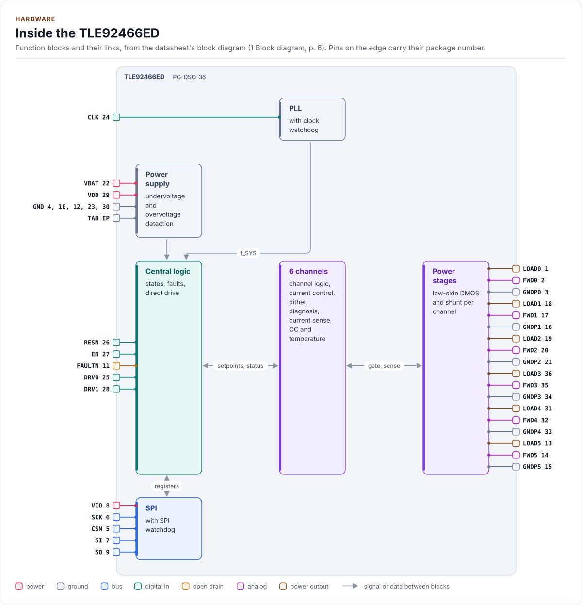
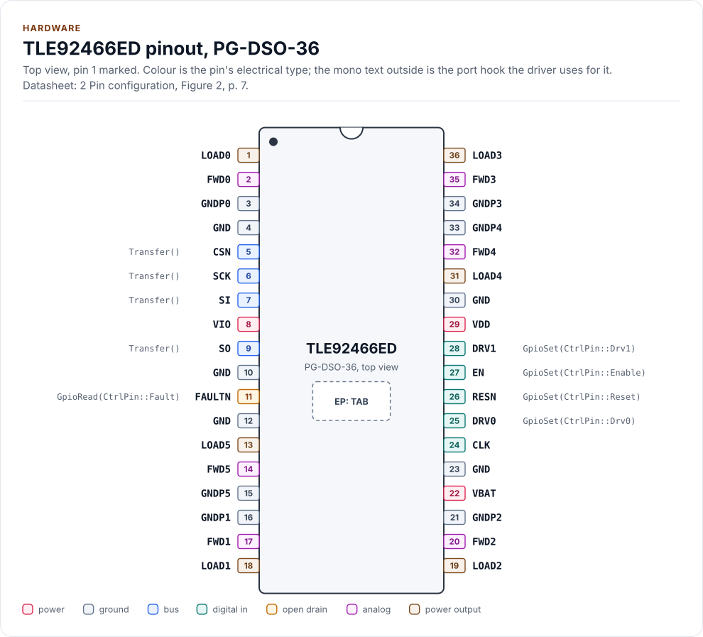

---
hide:
  - navigation
  - toc
---

<div class="kb-hero" markdown>
<span class="kb-kicker">Six-channel low-side solenoid driver</span>

# TLE92466ED Driver

<p>A C++20 driver for the Infineon TLE92466ED six-channel low-side solenoid driver. It starts the chip, regulates
each coil current with the chip's own controller and dither, reads the current feedback and the diagnosis, and
checks every SPI reply, on any MCU.</p>

[Quickstart](quickstart.md){ .md-button .md-button--primary }
[API guide](api-guide.md){ .md-button }
[Source on GitHub](https://github.com/kokeb-labs-drivers/driver-tle92466ed){ .md-button }
</div>

<!-- generated: chip-summary -->
The **TLE92466ED** is a six-channel low-side driver for solenoids and valves: each channel switches its load through an
integrated MOSFET and regulates the coil current itself, with an optional dither on top (Features, [p.
1](https://www.infineon.com/assets/row/public/documents/10/49/infineon-tle92466ed-datasheet-en.pdf#page=1)).
<!-- /generated -->

<!-- figure: chip-hero -->
<picture>
  <source media="(prefers-color-scheme: dark)" srcset="diagrams/chip-hero.dark.svg">
  
</picture>
<!-- /figure -->

## What it does

<!-- figure: chip-capabilities -->
<picture>
  <source media="(prefers-color-scheme: dark)" srcset="diagrams/chip-capabilities.dark.svg">
  
</picture>
<!-- /figure -->

## Where it is used

<!-- generated: chip-uses -->
- Variable force solenoids in automatic transmissions and e-axles
- Idle air control
- Exhaust gas recirculation
- Vapor management valves
- Suspension control
- Other constant-current solenoids

Uses named by the datasheet (Features, [p.
1](https://www.infineon.com/assets/row/public/documents/10/49/infineon-tle92466ed-datasheet-en.pdf#page=1)).
<!-- /generated -->

## Inside the chip

<!-- figure: chip-blocks -->
<picture>
  <source media="(prefers-color-scheme: dark)" srcset="diagrams/chip-blocks.dark.svg">
  
</picture>
<!-- /figure -->

## Pins and wiring

<!-- figure: chip-pinout -->
<picture>
  <source media="(prefers-color-scheme: dark)" srcset="diagrams/chip-pinout.dark.svg">
  
</picture>
<!-- /figure -->

<!-- figure: chip-wiring-typical -->
<picture>
  <source media="(prefers-color-scheme: dark)" srcset="diagrams/chip-wiring-typical.dark.svg">
  
</picture>
<!-- /figure -->

<!-- figure: chip-frame-spi -->
<picture>
  <source media="(prefers-color-scheme: dark)" srcset="diagrams/chip-frame-spi.dark.svg">
  
</picture>
<!-- /figure -->

Every pin, the application circuit, the bus settings, the timing and the power: [Hardware](hardware.md).

## Quick start

Wire the chip as above, write the port ([Porting](porting.md)), then drive a valve:

```cpp
--8<-- "tests/docs/quickstart.cpp:quickstart"
```

The steps explained: [Quickstart](quickstart.md).

## Driver coverage

<!-- generated: chip-coverage -->
| Capability | What the chip does | Driver API | Registers | Status | Datasheet |
| --- | --- | --- | --- | --- | --- |
| [Integrating current controller](api-guide.md) | Holds each coil at a current setpoint from 0 to 1.5 A, with the PWM frequency regulated to a target | `SetCurrent`, `ConfigureChannel`, `EnableChannel`, `DisableChannel` | `SETPOINT`, `CTRL`, `PERIOD`, `INTEGRATOR_LIMIT`, `CTRL_INT_THRESH`, `CH_CTRL` | Supported | 4.6.2, [p. 24](https://www.infineon.com/assets/row/public/documents/10/49/infineon-tle92466ed-datasheet-en.pdf#page=24) |
| [Dither](api-guide.md) | Adds a triangular or trapezoidal ripple to the setpoint to keep a valve spool moving freely | `SetDither` | `DITHER_CLK_DIV`, `DITHER_STEP`, `DITHER_CTRL` | Supported | 4.7.1, [p. 29](https://www.infineon.com/assets/row/public/documents/10/49/infineon-tle92466ed-datasheet-en.pdf#page=29) |
| [Parallel channels](api-guide.md) | Joins channels 0/3, 1/2 or 4/5 into one output for a larger load current | `SetParallel` | `CH_CTRL` | Supported | 4.5.2, [p. 22](https://www.infineon.com/assets/row/public/documents/10/49/infineon-tle92466ed-datasheet-en.pdf#page=22) |
| [Direct drive](api-guide.md) | Switches a channel without current control: a fixed on-time set over SPI, or following DRV0 or DRV1 | `ChannelMode::DirectDriveSpi`, `SetDrivePin` | `MODE`, `TON` | Supported | 4.8.1, [p. 32](https://www.infineon.com/assets/row/public/documents/10/49/infineon-tle92466ed-datasheet-en.pdf#page=32) |
| [Current feedback](api-guide.md) | Reports each channel's average current, minimum and maximum, duty cycle and VBAT (FB_I_AVG_s16 and FB_INT_THRESH only through ReadRegister) | `ReadChannelFeedback` | `FB_I_AVG`, `FB_IMIN_IMAX`, `FB_DC`, `FB_VBAT`, `FB_FRZ`, `FB_UPD` | Supported | 4.10.2, [p. 41](https://www.infineon.com/assets/row/public/documents/10/49/infineon-tle92466ed-datasheet-en.pdf#page=41) |
| [Load diagnosis](troubleshooting.md) | Detects open load, short to ground and overcurrent per channel, in the on and the off state | `ReadFaults`, `ClearChannelFaults`, `StartOvercurrentCheck` | `CH_CONFIG`, `DIAG_ERR_CHGR`, `DIAG_WARN_CHGR` | Supported | 4.9.1, [p. 32](https://www.infineon.com/assets/row/public/documents/10/49/infineon-tle92466ed-datasheet-en.pdf#page=32) |
| [Supply and temperature monitoring](api-guide.md) | Measures VBAT, VDD, VIO and the die temperature and flags under- and overvoltage and overtemperature | `ReadSupply`, `ReadFaults`, `ClearFaults` | `FB_VOLTAGE1`, `FB_VOLTAGE2`, `VBAT_TH`, `GLOBAL_DIAG0`, `GLOBAL_DIAG1`, `GLOBAL_DIAG2` | Supported | 4.1.2, [p. 14](https://www.infineon.com/assets/row/public/documents/10/49/infineon-tle92466ed-datasheet-en.pdf#page=14) |
| [Operation states and watchdogs](api-guide.md) | Config and Mission Mode, the SPI and clock watchdogs, CRC-checked frames and the built-in self-test | `EnterMissionMode`, `EnterConfigMode`, `ReloadWatchdog`, `RunBist` | `CH_CTRL`, `GLOBAL_CONFIG`, `WD_RELOAD`, `SFF_BIST`, `FB_STAT` | Supported | 4.3.1, [p. 19](https://www.infineon.com/assets/row/public/documents/10/49/infineon-tle92466ed-datasheet-en.pdf#page=19) |
| [Monitor test modes](limitations.md) | Test bits that fake a supply or overtemperature fault; two of them reset the chip, so they stay 0 | - | `GLOBAL_CONFIG` | Not covered | 5.3.2.4, [p. 58](https://www.infineon.com/assets/row/public/documents/10/49/infineon-tle92466ed-datasheet-en.pdf#page=58) |

**Supported**: the driver covers it and a host test checks it; **Not covered**: the chip has it and the driver leaves it
alone.

From [`docs/hardware.yml`](hardware.yml); `kokeb-docs hardware --check` confirms that every API name is in
`inc/tle92466ed.hpp`, `inc/tle92466ed_types.hpp` and every register in `inc/tle92466ed_registers.hpp`.
<!-- /generated -->

The driver has no platform code. You give it a small class that brings the bus up and moves 32-bit frames; it does
the rest: the reset and start-up sequence, the operation states, the frame CRC, the one-frame reply pipeline, unit
conversion, fault latching and bounded waits.

- **One object per chip.** `TLE92466ED<YourPort>` takes a reference to your port and does no I/O until
  `EnsureInitialized()`. See [API guide](api-guide.md).
- **Errors you can act on.** Every call returns `Result<T>` with an `Error` such as `NoDevice`, `MissionBlocked` or
  `CriticalFault`. See [API guide](api-guide.md#handle-errors).
- **Replies proven before they are used.** CRC, reply width, R/W echo, status and an anchor read in every access:
  a stuck, looped-back or out-of-step bus is an error, never data. See [Architecture](architecture.md).
- **Datasheet defaults.** `Config{}` holds the chip's reset values, with units in the field names, plus a
  current-control preset. See [Configuration](configuration.md).
- **Zero-overhead portability.** The port is a CRTP class checked by a concept: the bus hooks and a delay, plus
  optional RESN, EN, DRV, FAULTN and logging hooks found at compile time. See [Porting](porting.md).
- **No heap, no exceptions, no RTTI.** The host tests build with `-fno-exceptions -fno-rtti`. See
  [Contract](contract.md).
- **Tested without hardware, honest about it.** Host tests run the driver against a protocol model of the chip;
  what only a bench can confirm is listed in [Status and limitations](limitations.md).

## Datasheet

<!-- generated: datasheet-card -->
| Document | Revision | Get it |
| --- | --- | --- |
| Datasheet: TLE92466ED (Infineon IFX-ntz1491827137291) | 1.2, 2022-02-01 | [PDF](https://www.infineon.com/assets/row/public/documents/10/49/infineon-tle92466ed-datasheet-en.pdf) · [vendor page](https://www.infineon.com/part/TLE92466ED) |

Written against these revisions; the SHA-256 of each file is in [`docs/datasheets.yml`](datasheets.yml). Where each part
of the driver is in the datasheet: [Datasheet map](datasheet.md).
<!-- /generated -->

## Where to go next

<div class="grid cards" markdown>

-   :material-rocket-launch-outline: **[Quickstart](quickstart.md)**

    ---

    Wire the chip, write the port, regulate a coil current in about 20 lines.

-   :material-chip: **[Hardware](hardware.md)**

    ---

    Pins, bus settings, timing and power.

-   :material-file-document-check-outline: **[Contract](contract.md)**

    ---

    What the driver promises, what it needs, threading and errors.

-   :material-code-braces: **[API guide](api-guide.md)**

    ---

    Start, drive channels, read feedback and faults, handle errors, task by task.

-   :material-swap-horizontal: **[Porting](porting.md)**

    ---

    Implement the port for your MCU.

-   :material-book-open-variant: **[API reference](api-reference.md)**

    ---

    Every class and member, generated from the headers.

</div>
